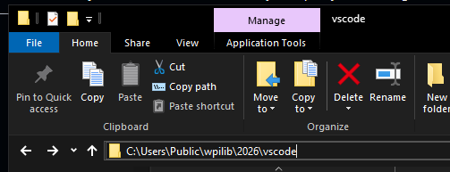
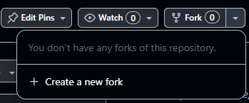
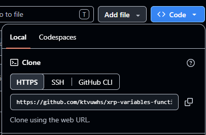
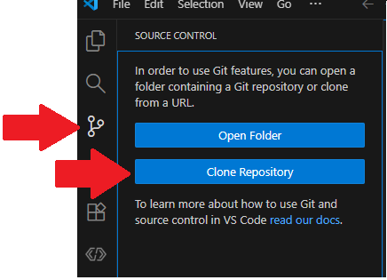
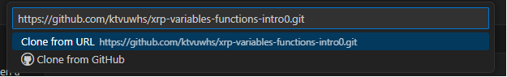
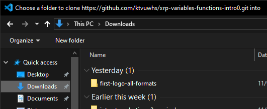
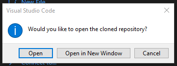

# Getting Starter Code

## Overview

This page will walk you through getting starter code onto your computer.


If you are using the same computer (or a personal computer) where you have already cloned the repository, then you simply need to open the folder in WPILib.  In the top-left, select File > Open Folder.  Go to where your repository is on the computer, and click "Select Folder" to open it.


## Opening WPILib (in K3 at WHS)

Open the current year's WPILib VSCode.

1. Open File Explorer.
2. Copy and paste this filepath into File Explorer.  (Alternatively, click on the following things and folders: This PC > Local Disk (C:) > Users > Public > wpilib > 2026 > vscode.)\
   `C:\Users\Public\wpilib\2026\vscode`&#x20;
3. **Note:** Replace the year "2026" with the year of WPILib you are working with.
4. Double click on "Code.exe" to launch the application.

<figure><figcaption>
Entering the filepath in File Explorer
</figcaption></figure>

## Forking a Repository

Forking the repository allows you to "own" a copy of the code on your Github account.


You only need to fork a repository once.  If you have already forked a repository to your account or if you do not care about owning a copy of the repository on your account, then skip this section and go straight to the next section to clone the files to your computer.


1. Login to your personal Github account.
2. Go to the starter code repository from the Internet.
3. In the top-right, click the arrow next to the Fork button, and select "Create a new fork".

<figure><figcaption></figcaption></figure>

4. Click "Create fork".
5. Now the files live on your Github account.  Follow the steps below to clone the files onto your computer to work on them.

## Cloning a Repository

Make sure you have opened WPILib on your computer before doing this.  We will clone the repository so that it creates a copy on your personal computer.


You only need to clone a repository once.  As long as you are using the same computer (or your personal device), then the repository should live in the same folder you cloned it in last time.


1. Go to the repository you want to clone.
2. Click on the "Code" button.
3. Copy the clone URL.

<figure><figcaption></figcaption></figure>

4. Go back to the WPILib VSCode.  Click on the branch icon, then "Clone Repository".

<figure><figcaption></figcaption></figure>

5. Paste the URL you copied earlier (CTRL+V).
6. Select clone from URL.

<figure><figcaption></figcaption></figure>

7. Select the folder you would like to clone the files to (usually Documents or Downloads).  Click on "Select as Repository Destination".

<figure><figcaption></figcaption></figure>

8. Open the repository when prompted (can select "Open in Current Window" or "Open in New Window".

<figure><figcaption></figcaption></figure>
