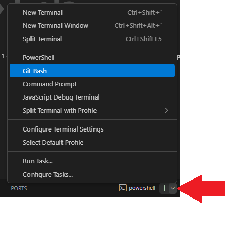
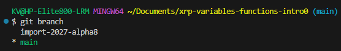
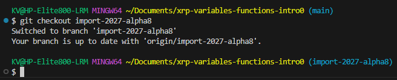

# Working with Git Branches

## Overview

Open a WPILib project in VSCode by either [cloning a repository](getting-starter-code.md#cloning-a-repository), or [creating a new WPILib project](wpilib-create-new-projects.md).  See the respective pages for walkthroughs.

## Opening a Git Terminal

We will first open a Git Terminal

1. The terminal should already open in VSCode.  If not, then click on View > Terminal (or press CTRL+\`).
2. To make it easier to see which branch we are on, click on the arrow next to the plus sign and select "Git Bash".  This will open a Git terminal for us.

<figure><figcaption></figcaption></figure>

## Creating a New Branch

Follow these steps when creating new branches for yourself.

1. In the terminal, write `git branch branch_name`, and replace `branch_name` with the name of the new branch you wish to create.  Hit "Enter" on your keyboard.
2. Switch to your new branch with the command `git checkout branch_name` and replace `branch_name` with the name of the branch you want to switch to.

## Switching to a Branch

If your branch already exists, then follow these steps.

1. Verify your branch exists by using the command `git branch` .
   1. If you know your branch exists, and it is not listed, then use the command `git pull`.  Check if it exists with `git branch` again.

<figure><figcaption></figcaption></figure>

2. Switch to the branch by using the command `git checkout branch_name`, and replace `branch_name` with the name of the branch you want to switch to.

<figure><figcaption></figcaption></figure>
