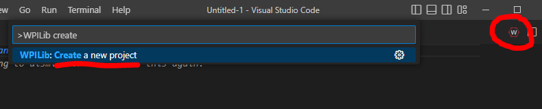
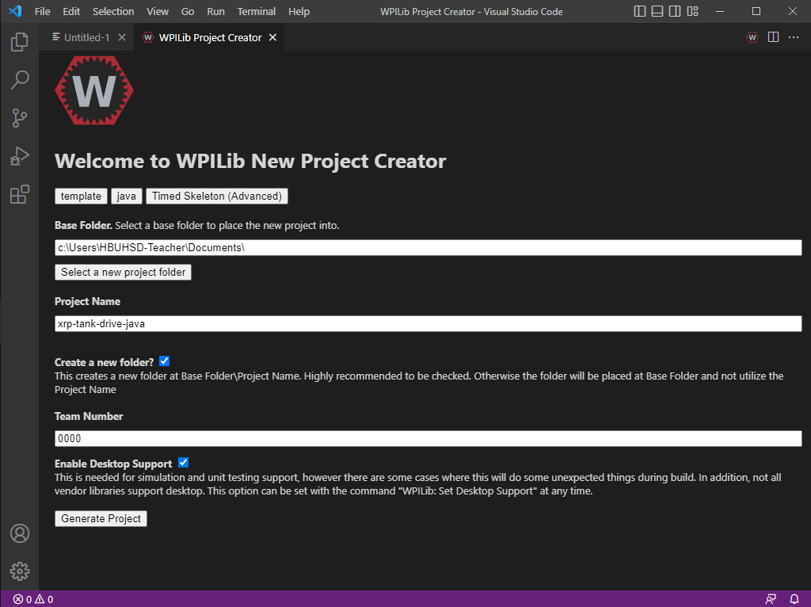

# WPILib: Create New Projects

### Creating a New WPILib Project

1. Open WPILib VSCode.  Click on the WPILib symbol in the top right to open up the command palette, or press CTRL+Shift+P (Windows), and select "Create new project". 

<figure><figcaption>
Command Palette: Create a new project
</figcaption></figure>

2. For project type, select "Template".
3. Select your preferred language (C++/Java).
4. Depending on how you want to program your robot, you will most often choose either "Timed Skeleton (Advanced)", or "Command Robot Skeleton (Advanced)".  Choose one.
5. Click "Select a new project folder" and choose the folder you wish to save your project in
6. Give your project a name, and put in your team number.
7. Make sure you check the box to enable Desktop Support.
8. Click "Generate Project", and select "Yes (Open in current window)".

<figure><figcaption>
Creating a new project
</figcaption></figure>
