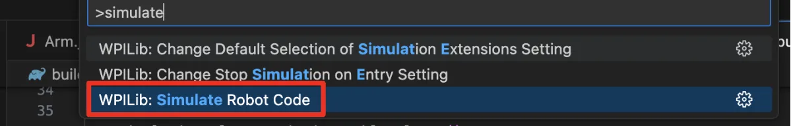
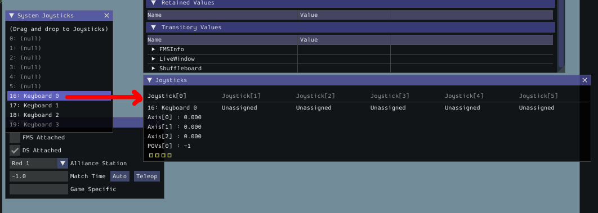

# WPILib: Simulate Code

1. Turn on the robot, and connect to it (ethernet or WiFi).
2. In WPILib VSCode, open the Command Palette by either clicking the WPILib icon in the top-right, or by pressing Ctrl+Shift+P (Windows).
3. Search for and select "Simulate Robot Code".
4. Press "OK" when prompted at the top.

<figure><figcaption></figcaption></figure>

5. Plug in your gamepad/controller (if you have one), and drag it from the "System Joysticks" table to the "Joysticks" table
6. If you do not have a gamepad, you can always use the Keyboard 0 joystick.  The controls are WASD, with ER being Axis 2, and the Z, X, C, and V keys on the keyboard being buttons.
7. Set your joystick to the joystick port that you used in your program code (e.g., port 0).

<figure><figcaption></figcaption></figure>

8. In the top left of the simulator GUI, switch your operating mode (usually Autonomous or Teleoperated).
9. Your robot should now run based on the code given (and based on which mode you are operating in).
