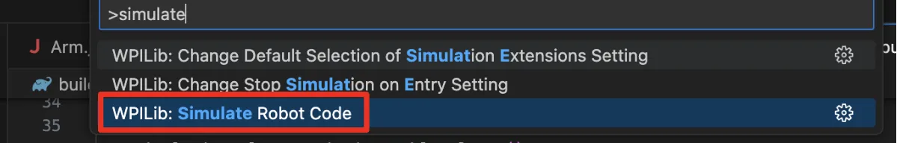
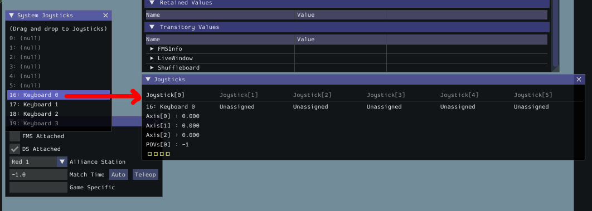

# Running Code on an XRP

To "deploy" our code to the XRP to test it, we need to connect to it and simulate our code.


If connecting to the XRP using it's default WiFi, then you can skip Step 1 and go straight to Step 2.


1.  Go to the `build.gradle` file and update the IP address to be the IP address of your specific XRP. 

    <pre class="language-java" data-title="build.gradle" data-line-numbers><code class="lang-java">// Update "10.0.0.2" to the IP Address of your XRP
    // This can typically be found around line 45-ish in build.gradle
    wpi.sim.envVar("HALSIMWS_HOST", "10.0.0.2")
    </code></pre>
2. In WPILib VSCode, open the Command Palette by either clicking the WPILib icon in the top-right, or by pressing Ctrl+Shift+P (Windows).
3. Search for and select "Simulate Robot Code".
4. Press "OK" when prompted at the top.

<figure><figcaption></figcaption></figure>

5. Drag your desired controller from the "System Joysticks" table to the "Joysticks" table in the same controller port used by your code (usually `Joystick[0]`).
6. If you do not have a gamepad, you can always use the Keyboard 0 joystick.  The controls are WASD, with ER being Axis 2, and the Z, X, C, and V keys on the keyboard being buttons.

<figure><figcaption></figcaption></figure>

8. In the top left of the simulator GUI, switch your operating mode to Teleoperated.
9. Your robot should now run.
