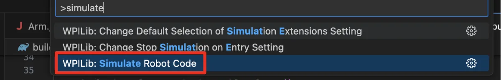
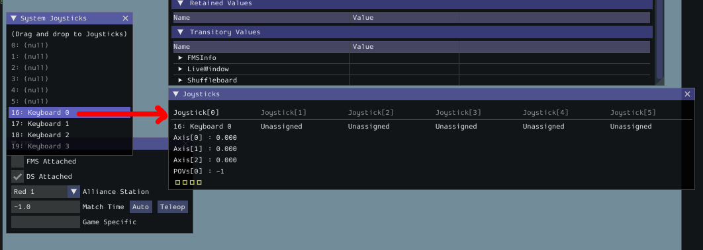

# Driving the XRP

## Starter Code

We will use the starter code found here: [https://github.com/CyberLions-8521/xrp-variables-functions-intro0](https://github.com/CyberLions-8521/xrp-variables-functions-intro0)

If you have not already, then clone the starter code repository to your computer by following the steps in [Getting Starter Code](../../getting-started/getting-started/getting-starter-code.md).

## Overview

This tutorial will introduce you to the robot code and driving the XRP robot.

## The Code

1. We will write our code within the `Robot.java` file.
   1. On the left hand side, open the `src` folder (sometimes combined as `src\main` ).
   2. Then, open the `main` folder.
   3. Then, open the `java\frc\robot` folders.
   4. Double click on `Robot.java` to open it.
2. We will write our code within the `teleopPeriodic` section.  The `periodic` means that the code will loop, run, and repeat forever.
3. <pre class="language-java" data-title="Robot.java" data-line-numbers><code class="lang-java">@Override
   public void teleopInit() {

   }

   @Override
   public void teleopPeriodic() {
       driveForward();
   }
   </code></pre>

## Running the XRP (Simulating the Code)

To "deploy" our code to the XRP to test it, we need to connect to it and simulate our code.


If connecting to the XRP using it's default WiFi, then you can skip Step 1 and go straight to Step 2.


1.  Go to the `build.gradle` file and update the IP address to be the IP address of your specific XRP. 

    <pre class="language-java" data-title="build.gradle" data-line-numbers><code class="lang-java">// Update "10.0.0.2" to the IP Address of your XRP
    // This can typically be found around line 45-ish in build.gradle
    wpi.sim.envVar("HALSIMWS_HOST", "10.0.0.2")
    </code></pre>
2. In WPILib VSCode, open the Command Palette by either clicking the WPILib icon in the top-right, or by pressing Ctrl+Shift+P (Windows).
3. Search for and select "Simulate Robot Code".
4. Press "OK" when prompted at the top.

<figure><figcaption></figcaption></figure>

5. Drag your desired controller from the "System Joysticks" table to the "Joysticks" table in the same controller port used by your code (usually `Joystick[0]`).
6. If you do not have a gamepad, you can always use the Keyboard 0 joystick.  The controls are WASD, with ER being Axis 2, and the Z, X, C, and V keys on the keyboard being buttons.

<figure><figcaption></figcaption></figure>

8. In the top left of the simulator GUI, switch your operating mode to Teleoperated.
9. Your robot should now run.

## Extension

Congratulations, you have successfully driven your first XRP.  The starter code has additional functions you can play around with to interact with your robot.

* **Challenge 1** - Get your robot to drive in reverse.
* **Challenge 2** - Get your robot to drive in reverse **without** using the `driveReverse()` function.
* **Challenge 3** - Get your robot to turn in place.
* **Challenge 4** - Get your robot to drive in a circle (as in, your robot should constantly be slightly turning and slightly driving forwards or backwards).  Can you figure out how to change the radius of the circle it drives in?

<table><thead><tr><th width="187">Function</th><th>Description</th></tr></thead><tbody><tr><td><code>driveForward()</code></td><td>The robot drives forward.</td></tr><tr><td><code>driveReverse()</code></td><td>The robot drives backwards.</td></tr><tr><td><code>drive(fwd, turn)</code></td><td>The robot drives forward with the effort specified by <code>fwd</code> and turns with the effort specified by <code>turn</code>.  The range of allowed values for <code>fwd</code> and <code>turn</code> are between <code>-1.0</code> and <code>1.0</code>.</td></tr></tbody></table>
