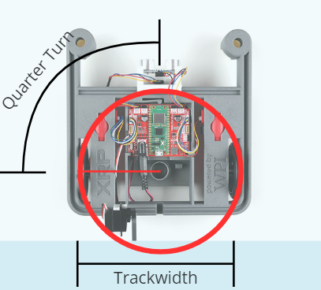

# Extension 3 - Turning

## Extension 3 - Turning with Encoders

One way to turn the robot at a right angle (left or right turn) is to make the motors run until the robot has traced out one-fourth of a circle (a quarter-turn).  Modify your autonomous routine so that the robot makes (near) perfect left and right turns.  The image below shows _one way_ to think about the problem (how to turn in place).  There is more than one way to solve the problem, and more than one way to turn (e.g., turning in place, or turning on a pivot).


If you want a different challenge, then see if you can complete this using the XRP gyroscope.  This allows you to use the gyroscope as a sensor / measuring device, instead of relying on the encoders.


<figure><figcaption>
Circle traced out when turning in place
</figcaption></figure>
